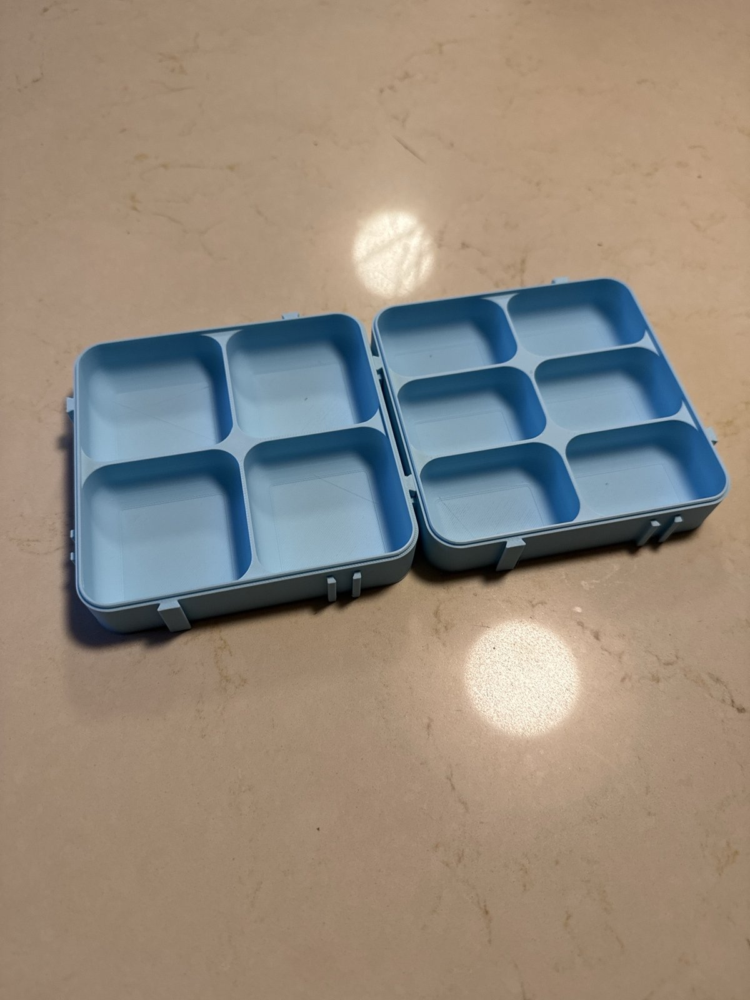
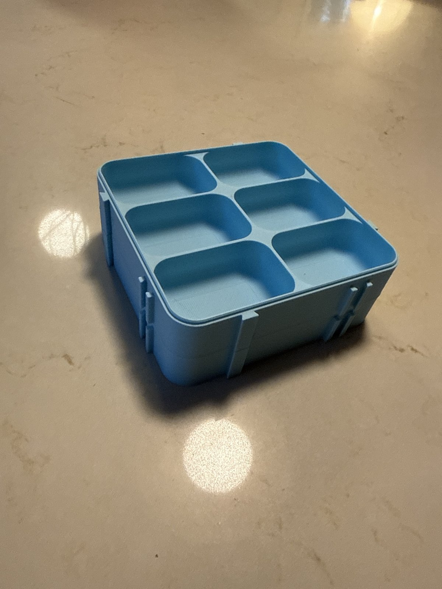
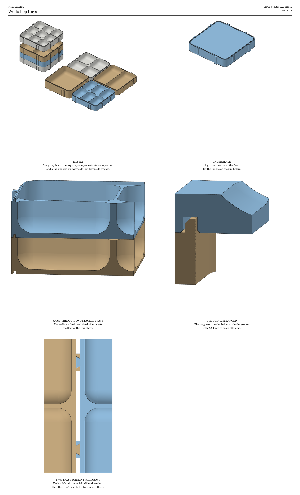
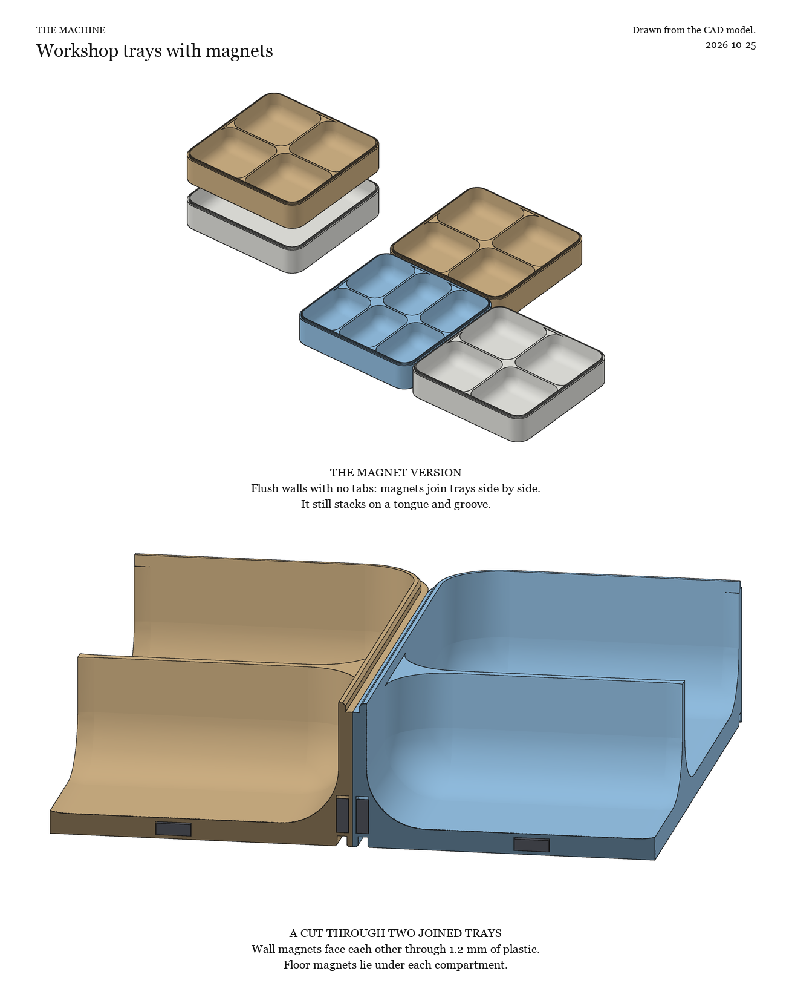

# Trays

These are shallow stacking trays for a workshop desk, sized for screws, nuts, small electronic parts and small prints. Every tray is the same 120 mm square, so any tray stacks on any other, and trays join together side by side on the desk. Every inside corner is a 10 mm curve, round in plan and from the floor up the wall, so a fingertip can sweep a small screw out of a corner.

<p>


</p>

The four- and six-compartment trays have been printed in PLA on a Bambu Lab X2D, and they stack and join as designed. The other trays come from the same script but haven't been printed yet, and the magnet version hasn't been printed at all.

They were made for the workshop of [THE MACHINE](https://cultofthemachine.org), an art project of mechanical instruments.

## The trays

The STLs are in `stl/`, each standing the way it prints.

| File | Compartments | Inside depth |
|---|---|---|
| `open.stl` | One | 20 mm |
| `two.stl` | Two | 20 mm |
| `four.stl` | Four, 2 x 2 | 20 mm |
| `six.stl` | Six, 3 x 2 | 20 mm |
| `nine.stl` | Nine, 3 x 3 | 20 mm |
| `open-deep.stl` | One | 30 mm |
| `fit-test.stl` | A small 50 mm tray with the same rim and groove and no tabs, for checking the stacking fit on your printer | 8 mm |

## How they stack and join

A low tongue runs round the inside edge of every rim, and a matching groove runs under every tray. The tray above sits flat on the rim with the tongue in its groove, so a stack can't slide apart and the outside walls stay flush. The dividers run up to the rim, so the tray above closes each compartment like a lid, and small parts can't hop from one compartment to the next when a drawer shuts.

Each side has a dovetail tab on its left and a matching slot on its right, both standing 3 mm out from the wall. Because every side has one of each, any side of any tray joins any side of another, whichever way round the trays are turned. Lower a tray beside another and the tabs slide down into the slots. Lift it straight up to part them. With the tabs, a tray measures 125.5 mm across, and joined trays sit 3 mm apart.



## Printing

The trays print the way they stand, with no supports. The groove under the floor has a short bridged roof, which prints cleanly without anything under it. The printed pair used PLA at 0.16 mm layers with Bambu Studio's standard settings, and a four- and a six-compartment tray together took 4 hours 6 minutes and 150 g. On a 256 mm bed, two trays fit on one plate, one behind the other.

The stacking fit has 0.25 mm of clearance all round, and the tabs and slots have the same. If stacks come out tight or loose on your printer, print two fit tests, change `FIT` in `model.py`, and remake the files.

## The magnet version

The trays in `stl/magnets/` have flush walls and no tabs. They're designed for 6 x 2 mm neodymium disc magnets, buried in the plastic while the print is paused. Two magnets on each side stand on edge low in the wall, facing out, and pull trays together side by side. One or more lie flat in the floor under each compartment and hold small steel parts down. A tray takes 12 to 17 magnets, depending on how many compartments it has. The floor is thicker, 3.6 mm, to bury them, so these trays are 2 mm taller than the plain ones. Both kinds stack on each other.

To print one, add two pauses in your slicer. The first goes at the first layer at or above 2.9 mm, and that's when the floor magnets go in, either way up. The second goes at the first layer at or above 8.9 mm, for the wall magnets. In Bambu Studio, pauses are added on the layer slider in the preview.

The wall magnets have to go in the right way round. Facing any side from outside, the left magnet has one pole out and the right magnet the other, which is what lets any side join any side. You don't need to know which pole is which. Mark the top face of a stack of magnets, then put every left magnet in with the marked face out and every right magnet with the marked face in. Before the print carries on, check that each magnet sits below the top of its pocket, so the nozzle passes clear over it.

Measure your magnets before printing. Cheap ones are often a tenth of a millimetre off their listed size, and a buried magnet needs a snug pocket. Change `MAGNET_D` and `MAGNET_T` in `model.py` to match and remake the files.

This version is untested. The pockets are drawn with at least 0.6 mm of plastic around every magnet.



## Changing the design

The trays are modelled in Python with [build123d](https://build123d.readthedocs.io). With [uv](https://docs.astral.sh/uv/) installed, run this from this folder to remake every STL and both pictures:

```bash
uv run model.py
```

The first run installs build123d, which takes a few minutes. After that it takes a minute or two.

To make one tray of your own, give its compartments across and deep, and its inside depth in millimeters. Add `--magnets` for the magnet version.

```bash
uv run model.py --dividers 4x2 --depth 15
```

Everything else is set by the numbers at the top of `model.py`, among them the tray size, the curve of the corners, the wall and floor thickness, the clearances, the tab sizes and the magnet sizes. `shade.py` draws the pictures from the model.

## License

The models, pictures and this README are under the [Creative Commons Attribution 4.0 license](LICENSE). You can print, change and share them, even commercially, as long as you credit Matthew Starcher. The code in `model.py` and `shade.py` is under the [MIT License](LICENSE-CODE).
